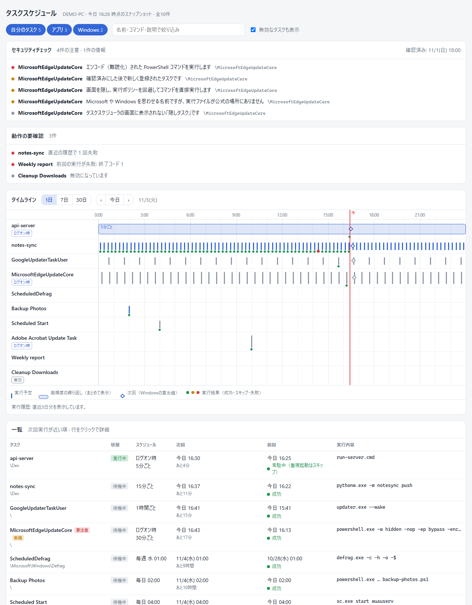
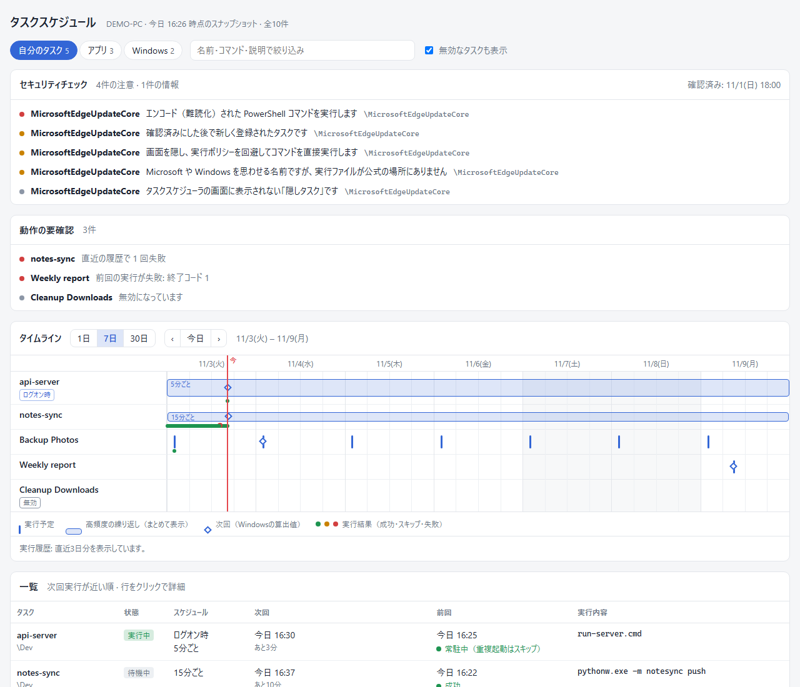
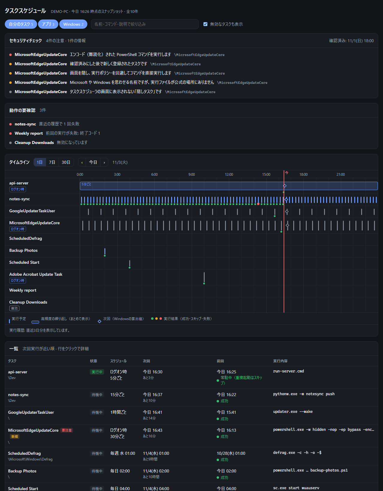
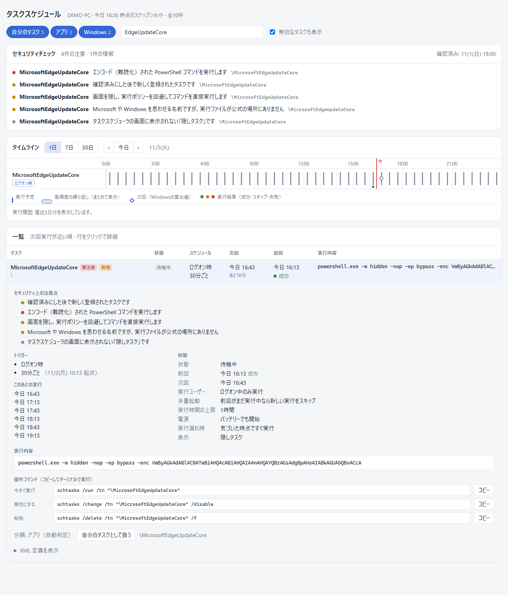

# taskviz

[](https://github.com/KMYsqHRK/taskviz/actions/workflows/ci.yml)
[](LICENSE)


> [!IMPORTANT]
> **Windows 専用です。** Windows のタスクスケジューラ（`Schedule.Service` COM）を読み取るツールのため、macOS / Linux では動きません。

Windows のタスクスケジューラに「何が・いつ・何を実行するように」登録されているかを、ブラウザで一目で見られるようにするツールです。
自分の PC の中だけ（`127.0.0.1`）で小さな Web サーバーを立ち上げ、登録済みのタスクをその場で読み取って表示します。

自分で登録したタスクの見通しをよくするだけでなく、**マルウェアがこっそり登録したタスクを見つける監視ツール**としても使えます（[セキュリティチェック](#セキュリティチェック不審なタスクの検出)）。



<sub>※ スクリーンショットはすべて架空のデモデータ（[`tools/New-DemoData.ps1`](tools/New-DemoData.ps1)）から生成しています。</sub>

## できること

- **タイムライン** — 1日 / 7日 / 30日の範囲で、各タスクがいつ動くかを表示します。5分ごとのような高頻度のタスクは帯にまとめます。
- **一覧** — 次回実行が近い順に、スケジュールを日本語で表示します（例: 「毎週 月 09:00」「5分ごと」「ログオン時」）。前回の結果も表示します。
- **詳細** — 実行コマンド、作業フォルダ、多重起動の扱い、実行時間の上限、電源条件、XML 定義を確認できます。
- **セキュリティチェック** — 不審な特徴を持つタスクと、確認済みの状態から追加・変更されたタスクを知らせます。
- **動作の要確認** — 失敗したタスク、実行されなかった回、今後の実行予定がないタスクをまとめて表示します。
- **操作** — 今すぐ実行 / 停止 / 有効化 / 無効化をボタンで行えます。削除は誤操作を避けるため、コマンドのコピーだけにしています。
- **分類** — 「自分のタスク / アプリ / Windows」を自動で判定します。判定はタスクごとに手動で変えられます。

外部への通信はしません。ライブラリやランタイムのインストールも不要です。

| 週表示 | ダークモード |
| --- | --- |
|  |  |

## 動作環境

- **Windows 10 / 11**（Windows PowerShell 5.1 は標準で入っています。PowerShell 7 でも動きます）
- Edge / Chrome / Firefox などの最近のブラウザ
- 管理者権限は不要です（Windows のシステムタスクを操作するときだけ必要です）

CI では Windows Server 2022 / 2025 上で、Windows PowerShell 5.1 と PowerShell 7 の両方についてテストしています。

## 使い方

```bat
git clone https://github.com/KMYsqHRK/taskviz.git
cd taskviz
taskviz.cmd
```

`taskviz.cmd` をダブルクリックしても起動できます。ブラウザで `http://127.0.0.1:31415/` が開きます。
ポート 31415 が使用中なら、空いているポートを順に探して使います。ポートを使うのは起動している間だけです。
止めるときは、コンソールで Ctrl+C を押すか、ウィンドウを閉じるか、画面右上の「終了」を押してください。

### オプション

```powershell
.\taskviz.ps1 -Port 9000             # 使うポートを指定する（taskviz.cmd -Port 9000 でも可）
.\taskviz.ps1 -NoOpen                # ブラウザを自動で開かない
.\taskviz.ps1 -HistoryDays 7         # 実行履歴を何日分読むか（既定 3 日）
.\taskviz.ps1 -Export snapshot.html  # サーバーを立てず、その時点のスナップショットを 1 ファイルの HTML に出力
```

URL の `#` 以降で表示を指定できます（ブックマーク用）。例: `http://127.0.0.1:31415/#range=week&cats=mine,app&open=\MyTask`

## セキュリティチェック（不審なタスクの検出）

タスクスケジューラは、マルウェアが PC に居座るためによく使う場所です（[MITRE ATT&CK T1053.005](https://attack.mitre.org/techniques/T1053/005/)）。
taskviz は、カテゴリの絞り込みに関係なく**すべてのタスク**を調べ、次のような兆候を画面上部の「セキュリティチェック」に表示します。



| 重さ | 検出する内容 |
| --- | --- |
| 高 | エンコード（難読化）された PowerShell コマンド（`-EncodedCommand` / `-enc`） |
| 高 | 文字列をその場でコードとして実行する（`Invoke-Expression` / `iex`） |
| 高 | インターネットからダウンロードする処理（`DownloadString`、`Invoke-WebRequest`、`certutil -urlcache`、`bitsadmin /transfer` など） |
| 高 | 一時フォルダや共有フォルダ（`%TEMP%`、`C:\Users\Public` など）にあるファイルの実行 |
| 高 | SYSTEM 権限で、一般ユーザーが書き換えられる場所のファイルを実行する |
| 中 | `mshta` / `rundll32` / `regsvr32` / `wscript` など、悪用されやすい Windows 標準ツールを経由した実行（`\Microsoft\` 以外） |
| 中 | 画面を隠し、実行ポリシーを回避して、コマンドを直接実行する PowerShell |
| 中 | Microsoft / Windows を思わせる名前なのに、実行ファイルが公式の場所にない |
| 中 | 引数に URL を含む |
| 低 | タスクスケジューラの画面に表示されない「隠しタスク」（`\Microsoft\` 以外） |

### 追加・変更の検出（ベースライン）

1. 今あるタスクを確認し、問題がなければ「**今の状態を確認済みにする**」を押します。
2. 各タスクの定義の指紋（XML の SHA-256）が `%LOCALAPPDATA%\taskviz\baseline.json` に保存されます。
3. 以降に**新しく登録されたタスク・内容が変わったタスク・削除されたタスク**が「セキュリティチェック」に表示されます。

身に覚えのないタスクが増えていないかを、ときどき開いて確認する使い方を想定しています。

> [!NOTE]
> 検出はあくまで目安です。正規のソフトウェアが引っかかることもあれば、巧妙なマルウェアを見逃すこともあります。
> ウイルス対策ソフト（Microsoft Defender など）の代わりにはなりません。不審なタスクを見つけたら、無効化したうえでウイルス対策ソフトでスキャンしてください。

## 実行履歴を表示したい場合

Windows の「タスクの履歴」は既定で無効です。そのため、過去の実行は「前回」の 1 回分しか表示されません。
管理者のターミナルで次のコマンドを実行して履歴を有効にすると、以降の実行がタイムラインに出るようになります。

```bat
wevtutil sl Microsoft-Windows-TaskScheduler/Operational /e:true
```

## 安全性について

- サーバーは `127.0.0.1` だけで待ち受けるため、他の PC からはポートに接続できません。ファイアウォールの設定には依存しません。
  （PowerShell の HttpListener は全ネットワークで待ち受けてしまうため、使っていません。）
- Host ヘッダーが `127.0.0.1` / `localhost` 以外のリクエストは拒否します（DNS リバインディング対策）。
- 実行・停止・有効化・無効化などの操作は、起動のたびに生成するトークンがないと受け付けません。トークンは taskviz 自身が配信するページにしか埋め込まれないため、他のサイトからは操作できません。
- タスクの操作は、起動したユーザーの権限で行います。taskviz 自身がタスクを登録・削除することはありません。
- 外部への通信はしません。CDN やトラッキングも使っていません。

これらは CI のテスト（[`tests/Run-Tests.ps1`](tests/Run-Tests.ps1)）で毎回確認しています。脆弱性の報告方法は [SECURITY.md](SECURITY.md) を見てください。

## 制限事項

- Windows 専用です。
- 画面は日本語のみです。
- 実行時刻にランダムな遅延が設定されたタスクは、タイムラインに「最も早い時刻」を表示します。Windows が実際に決めた次回の時刻は ◇ で表示します。
- 「自分のタスク」の自動判定は、実行内容がユーザーフォルダ内（AppData を除く）を指しているかどうかで行います。
- 管理者権限なしで起動した場合、一部のシステムタスクは詳細を読めないことがあります。

## 開発

```powershell
.\tests\Run-Tests.ps1            # テスト（実際のタスクは実行・変更しません）
.\tools\Update-Screenshots.ps1   # docs/screenshots をデモデータから再生成（Microsoft Edge を使用）
```

| ファイル | 役割 |
| --- | --- |
| `taskviz.ps1` | タスクの収集とローカルサーバー |
| `app.html` | 画面（HTML / CSS / JS を 1 ファイルにまとめたもの） |
| `taskviz.cmd` | ダブルクリックで起動するためのランチャー |
| `tests/Run-Tests.ps1` | スモークテスト |
| `tools/New-DemoData.ps1` | スクリーンショット・テスト用の架空データ |
| `tools/Update-Screenshots.ps1` | スクリーンショットの生成 |

## License

[MIT](LICENSE)
